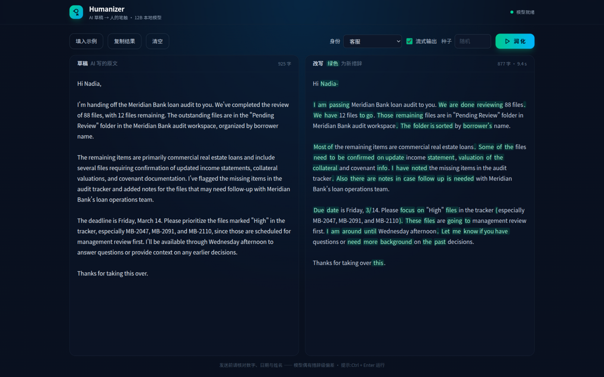

# humanizer API

用 FastAPI 把本地 humanizer 模型(`/home/feifei/develop/models/humanizer`,
jialinyyzz/humanizer,Gemma-4-12B 微调)提供成 HTTP 接口,把 AI 草稿改写成"像人写的"。

## 运行

```bash
./install.sh   # 安装依赖 (需要 uv); 不检查模型是否存在, 缺模型只提示
./server.sh    # 启动, 默认 http://127.0.0.1:8100, Ctrl+C 停止
```

等价于 `uv sync` + `uv run uvicorn server:app`。环境变量 `HUMANIZER_MODEL`(模型路径,
默认 `/home/feifei/develop/models/humanizer`)、`HUMANIZER_HOST`、`HUMANIZER_PORT` 对两个脚本都生效。

模型约 24GB(bf16),加载到 GPU(RTX 5090 D 实测占 22.3 GiB 显存),首次启动约 20 秒。
`GET /health` 返回 `{"status":"ok"}` 即就绪。

## 网页客户端



服务启动后直接打开 `http://127.0.0.1:8100/`:左边草稿、右边改写(新增措辞绿色高亮),
支持**写作身份**(21 个:默认、客服、同事、向上汇报、程序员、HR、知乎博主、机关公文等)、
流式逐字输出、可选随机种子、一键示例、复制,草稿和身份自动存 localStorage,Ctrl+Enter 运行。
Tailwind CSS 已下载到 `static/vendor/`,离线可用。

## 接口

### `POST /humanize`

```json
{
  "text": "AI 写的草稿,中英文均可",
  "identity": "customer_service", // 可选,写作身份,见 GET /identities;缺省 default
  "max_new_tokens": 2048,          // 可选,缺省按草稿 token 数的 2.5 倍收在 [256, 2048]
  "seed": 42                       // 可选,固定随机种子以便复现
}
```

返回:

```json
{"rewrite": "改写结果", "identity": "customer_service", "attempts": 1, "tokens_generated": 217, "seconds": 12.44}
```

- 请求串行执行(单卡单模型),超长草稿(prompt 超 8192 token)返回 413,请拆分后分段调用。
- 英文稿若改写结果混入大段中文,会自动用相同设置重采样,最多 3 次(AGENTS.md 建议的行为)。

### `GET /identities`

返回全部写作身份。实现方式:`default` 保持官方 prompt 逐字节不变(启动时指纹校验针对它);
其余身份在指令区末尾追加一句英文 `Write it in the voice of …`,草稿与分隔符结构不动——
这偏离了模型作者要求的逐字节 prompt,实测可用,但效果以 `default` 为准。

### `POST /humanize/stream`

参数同上,SSE 流式返回:`data: {"delta": "..."}\n\n`,以 `data: [DONE]` 结束。
流式路径只采样一次,不做语言重采样检查。

### `GET /health`

`{"status":"ok"}`(就绪)或 `{"status":"loading"}`(模型加载中)。

交互式文档:`http://127.0.0.1:8100/docs`。

## 实现要点(来自模型 README/AGENTS.md,勿改)

- **prompt 逐字节复刻** `prompt_format.json`:`instr + "\n\n" + draft.strip() + sep`,
  启动时校验 sha256 指纹 `cc51d66b4c593fbe`。中文稿也用同一条英文指令。
- **文本补全,不是 chat**:无系统提示、无轮次标记、不套聊天模板。
- **采样固定**:temperature 1.0、top_p 0.95、top_k 0(显式覆盖 generation_config.json
  里的 top_k 64)、min_p 0、repetition_penalty 1.0;只在 EOS 停,不设 stop 字符串。
- **上下文 8192 token**(指令 + 草稿 + 改写总量)。

## 自测

```bash
uv run python tests/selftest.py    # 服务启动后运行,用官方评估集的样例草稿
```

## 注意

模型仍可能改动细节(官方评测:英文改写 376/420 无事实问题,出错时 9 成为单个词)。
**发送前务必人工核对数字、日期、姓名和每个论断的方向。**
